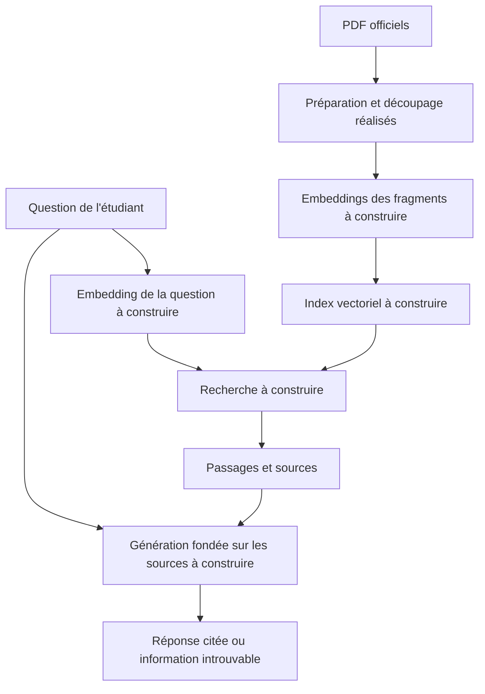
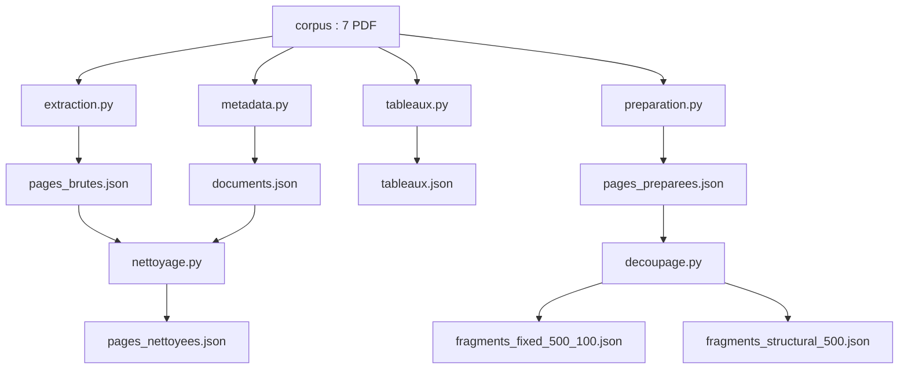
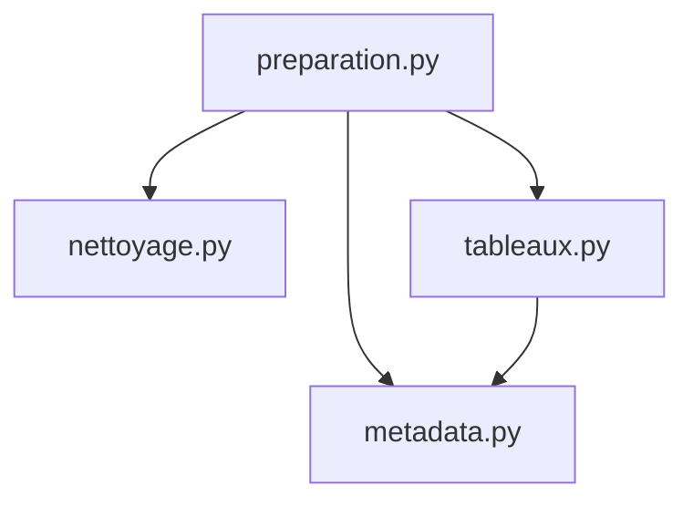
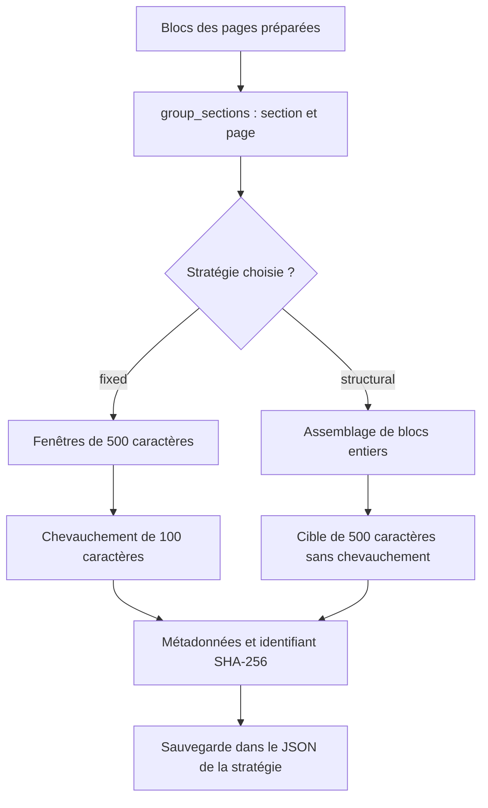
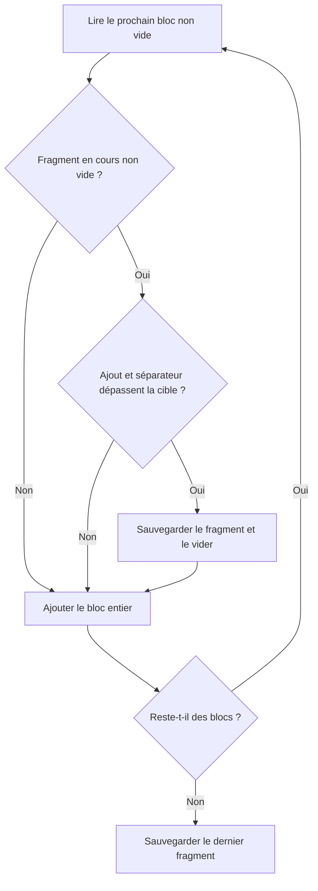

# Assistant Scolarité — RAG

Projet pédagogique de l'Université Mundiapolis, **3ACINFO — Module RAG**.  
Enseignant : **Pr. Habib Ayad**.

L'objectif est de construire une application répondant aux questions des étudiants à partir des documents officiels EIH, avec des citations précises. Si l'information ne figure pas dans les sources, l'assistant devra l'indiquer au lieu d'inventer une réponse.

**État documenté : préparation du corpus et découpage terminés ; 18 tests de découpage réussis.** Les embeddings, la base vectorielle, la génération, l'API et l'interface restent à implémenter.

## 1. Principe du RAG

Le **RAG** (*Retrieval-Augmented Generation*) associe une recherche documentaire à un modèle de langage :

1. Préparer les documents et les découper en fragments.
2. Transformer les fragments en vecteurs numériques, appelés *embeddings*.
3. Rechercher les fragments pertinents pour une question.
4. Fournir ces passages au modèle pour rédiger une réponse avec ses sources.

La première étape est réalisée dans la version décrite ici. Par exemple, une question sur les stages devra ensuite conduire à une recherche dans les passages du guide des stages, puis à une réponse citant le document et la page.

### 1.1 Architecture cible

Le schéma distingue la préparation déjà réalisée des étapes à construire. La recherche doit utiliser le même modèle d'embeddings pour les documents et les questions.



## 2. Environnement et installation

### 2.1 Prérequis

- Git pour récupérer et versionner le projet.
- Python 3.12 ; dernière exécution des tests avec **Python 3.12.15**.
- `uv` pour gérer les dépendances et exécuter les scripts.
- Les sept PDF du corpus placés dans `corpus/`.

Les dépendances du projet sont définies dans `pyproject.toml` et verrouillées dans `uv.lock`. Le traitement utilise notamment `pdfplumber`, Pydantic et `pytest` pour les tests.

### 2.2 Récupérer le projet

```powershell
git clone https://github.com/AymnBen/assistant-scolarite-rag.git
cd assistant-scolarite-rag
uv sync
uv run python --version
```

Si le projet est déjà présent sur le PC, ouvrir simplement un terminal à sa racine. Exemple d'emplacement de travail sous Windows :

```powershell
cd A:\assistant-scolarite-rag
uv sync
```

`uv sync` synchronise l'environnement avec les dépendances du projet. `uv run` lance une commande dans cet environnement, sans nécessiter son activation manuelle.

Si les tests échouent avec `No module named pytest` :

```powershell
uv add --dev pytest
```

Cette commande modifie les fichiers de dépendances ; leurs changements doivent être versionnés si nécessaire. Aucune clé de modèle de langage n'est nécessaire pour les étapes de préparation décrites ici.

## 3. Organisation du projet

| Emplacement | Rôle |
|---|---|
| `corpus/` | PDF sources, conservés sans modification. |
| `backend/` | Scripts Python de préparation ; accueillera ensuite le RAG et l'API. |
| `data/` | Fichiers JSON générés par les scripts. |
| `tests/` | Tests automatiques sur des données fictives. |
| `frontend/` | Emplacement prévu pour l'interface web. |
| `eval/` | Emplacement prévu pour l'évaluation du RAG. |
| `.venv/` | Environnement Python local. |
| `pyproject.toml` | Configuration du projet et dépendances. |
| `uv.lock` | Versions verrouillées des dépendances. |
| `.python-version` | Version Python souhaitée. |
| `.gitignore` | Règles définissant les fichiers ignorés par Git. |

Les dossiers prévus pour la suite peuvent être vides ou absents à ce stade. Ne pas versionner `.venv/`, les caches ou les secrets d'un futur `.env`.

## 4. Corpus documentaire

| Document | Pages | Tableaux de contenu | Lignes de tableaux |
|---|---:|---:|---:|
| Règlement des études 2026-2027 | 4 | 2 | 7 |
| Guide stages/PFE 2026 | 3 | 2 | 6 |
| Charte de mobilité internationale | 3 | 4 | 15 |
| Calendrier académique 2026-2027 | 2 | 3 | 27 |
| Guide de vie étudiante | 3 | 2 | 10 |
| FAQ scolarité | 2 | 0 | 0 |
| Note de service 2026-14 | 2 | 1 | 4 |
| **Total** | **19** | **14** | **69** |

Ces chiffres correspondent au corpus utilisé lors des exécutions de référence. Les scripts contrôlent la présence de sept PDF ; ce contrôle ne garantit pas à lui seul leur identité. Si les documents ne sont pas distribués dans le dépôt, il faut les obtenir séparément et les placer dans `corpus/`.

## 5. Vue d'ensemble des traitements

| Étape | Script | Fichier produit |
|---|---|---|
| Extraction page par page | `backend/extraction.py` | `data/pages_brutes.json` |
| Extraction des métadonnées | `backend/metadata.py` | `data/documents.json` |
| Nettoyage des marges répétées | `backend/nettoyage.py` | `data/pages_nettoyees.json` |
| Extraction structurée des tableaux | `backend/tableaux.py` | `data/tableaux.json` |
| Assemblage sans doublons | `backend/preparation.py` | `data/pages_preparees.json` |
| Découpage fixe | `backend/decoupage.py` | `data/fragments_fixed_500_100.json` |
| Découpage structurel | `backend/decoupage.py` | `data/fragments_structural_500.json` |

Les JSON intermédiaires servent à inspecter les résultats et comprendre les erreurs. `preparation.py` relit directement les PDF et réutilise les fonctions des autres modules : il ne concatène pas les anciens JSON. Le découpage lit ensuite `pages_preparees.json`.

### 5.1 Circulation des données

Les flèches ci-dessous représentent les lectures et les écritures de données. Les sorties intermédiaires permettent de contrôler l'extraction avant le découpage.



`preparation.py` relit les PDF : `pages_nettoyees.json` et `tableaux.json` ne sont pas ses fichiers d'entrée. En revanche, il réutilise du code des autres modules.

### 5.2 Réutilisation des fonctions

Dans ce schéma, une flèche signifie « importe des fonctions de ». Il s'agit de dépendances entre modules, pas de fichiers JSON échangés.



- Depuis `metadata.py` : `extract_metadata()`.
- Depuis `nettoyage.py` : `normalize_margin()`.
- Depuis `tableaux.py` : `is_metadata_table()` et `serialize_table()`.
- `tableaux.py` importe aussi `FIELD_NAMES`, `clean_cell()` et `extract_metadata()` depuis `metadata.py`.

## 6. Explication des scripts et fonctions

### 6.1 `backend/extraction.py` — Lire les PDF

**Objectif :** représenter chaque page par son texte, son fichier source et son numéro de page.

- `extract_pages(pdf_path)` ouvre un PDF avec `pdfplumber`, parcourt ses pages et renvoie leurs contenus.
- `main()` recherche les PDF, rassemble les pages et écrit `pages_brutes.json`.

La numérotation commence à **1**. L'extraction avec conservation de disposition facilite l'inspection du texte, mais ne suffit pas pour préserver les relations entre les colonnes des tableaux.

**Résultat de référence : 19 pages extraites.**

### 6.2 `backend/metadata.py` — Identifier les documents

**Objectif :** conserver les informations nécessaires à la provenance et aux futures citations.

| Élément | Rôle |
|---|---|
| `DocumentMetadata` | Modèle Pydantic qui définit et valide les métadonnées. |
| `clean_cell(value)` | Nettoie les espaces multiples et retours à la ligne d'une cellule. |
| `parse_french_date(value)` | Convertit une date française en date Python valide. |
| `extract_metadata(pdf_path)` | Lit le tableau de présentation de la première page. |
| `main()` | Traite le corpus et écrit `documents.json`. |

Champs conservés : `file`, `reference`, `type`, `date`, `version`, `status`. Le numéro `page` est ajouté aux contenus associés.

Exemple de normalisation : `1er septembre 2026` devient `2026-09-01`. La date de publication ne suffit pas à déterminer quelle règle prévaut en cas de contradiction ; le contenu et le champ d'application devront aussi être pris en compte.

### 6.3 `backend/nettoyage.py` — Retirer les marges répétées

**Objectif :** éviter de répéter les en-têtes et pieds de page dans les fragments.

- `normalize_margin(text)` uniformise une marge pour la comparer : `page 1` et `page 2` deviennent `page #`.
- `nonempty_lines(text)` récupère les lignes non vides.
- `clean_document(pages)` compte les premières et dernières lignes d'un même document et retire aux extrémités celles répétées au moins deux fois.
- `main()` lit les pages brutes et les métadonnées, associe les données et écrit `pages_nettoyees.json`.

**Résultat de référence : 19 pages nettoyées et 38 lignes supprimées.** Cette méthode est adaptée aux marges observées dans le corpus ; elle ne couvre pas tous les en-têtes multilignes possibles.

### 6.4 `backend/tableaux.py` — Conserver le sens des colonnes

**Objectif :** associer chaque valeur de tableau à son en-tête.

Exemple fictif de ligne sérialisée :

```text
Date : 10 juin — Événement : Examen — Public : 1A
```

- `is_metadata_table(rows)` reconnaît les tableaux de présentation, déjà traités par le module de métadonnées.
- `serialize_table(rows)` utilise la première ligne comme en-têtes, nettoie les cellules et produit des lignes textuelles explicites. Les cellules structurées sont aussi conservées.
- `extract_tables(pdf_path)` ajoute les métadonnées, la page, le numéro du tableau, le numéro de ligne et la zone `bbox`.
- `main()` écrit les résultats dans `tableaux.json`.

`bbox` contient quatre coordonnées : gauche, haut, droite et bas. Les cellules vides restent vides : aucune valeur n'est inventée.

**Résultat de référence : 14 tableaux de contenu, 69 lignes.**

### 6.5 `backend/preparation.py` — Assembler sans doublons

**Objectif :** remplacer le texte brut des tableaux par leurs lignes explicites, à leur position dans la page.

- `exclude_tables(page, tables)` filtre les caractères situés dans les zones de tableaux.
- Sa fonction interne `keep_object(obj)` vérifie si le centre d'un caractère appartient à une de ces zones.
- `prepare_document(pdf_path)` extrait le texte hors tableaux, retire les marges répétées, réintroduit les lignes de tableaux et trie les blocs selon leur position verticale.
- `main()` rassemble les pages et écrit `pages_preparees.json`.

Le PDF original n'est pas modifié. Les tableaux de métadonnées ne sont pas réintroduits, car leurs informations sont déjà attachées aux pages.

Une page possède deux représentations du même contenu :

| Champ | Contenu |
|---|---|
| `blocks` | Liste ordonnée de blocs : `text` pour une ligne de texte, `table_row` pour une ligne de tableau. |
| `text` | Texte obtenu en assemblant ces blocs. |

Le découpage utilise les blocs ; il n'ajoute pas une deuxième fois le champ `text` de la page.

**Résultat de référence : 19 pages préparées et 69 lignes de tableaux intégrées.**

### 6.6 `backend/decoupage.py` — Créer les fragments

**Objectif :** obtenir des passages pouvant ensuite être indexés et retrouvés par la recherche.

| Élément | Rôle |
|---|---|
| `SECTION_PATTERN` | Expression régulière reconnaissant notamment `Article 1`, `Titre II`, `2.1` et `Q1.`. |
| `group_sections(pages)` | Trie les pages et regroupe les blocs par section et par page. |
| `save_group()` | Fonction interne enregistrant les blocs accumulés pour un groupe. |
| `split_fixed(text, size, overlap)` | Découpe un texte en fenêtres de caractères avec chevauchement. |
| `create_fixed_chunks(pages, size, overlap)` | Ajoute les métadonnées et identifiants aux fragments fixes. |
| `create_structural_chunks(pages, size)` | Assemble les blocs entiers, avec leurs métadonnées et identifiants. |
| `main()` | Lit les options du terminal, lance la stratégie et sauvegarde le JSON. |

Le nom d'une section peut continuer sur la page suivante, mais chaque fragment conserve un numéro de page précis. Les titres non numérotés ne sont pas tous reconnus par l'expression régulière.

## 7. Comparaison des stratégies de découpage

| Critère | Fixe | Structurelle |
|---|---|---|
| Option | `--strategy fixed` | `--strategy structural` |
| Taille de 500 | Maximum strict | Taille cible |
| Chevauchement utilisé | 100 caractères | 0 |
| Unité conservée | Fenêtre de caractères | Bloc entier |
| Longue ligne de tableau | Peut être coupée | Conservée entière, même au-delà de la cible |
| Limites de section et de page | Respectées | Respectées |
| Résultat de référence | 151 fragments | 150 fragments |

Le choix de stratégie intervient après le regroupement commun par section et par page :



Les valeurs 500 et 100 correspondent à l'exécution de référence ; les paramètres sont configurables. En structurel, un bloc trop long dépasse la cible pour rester entier.

### 7.1 Exemple de découpage fixe

Pour `size=6` et `overlap=2` :

```text
Texte : ABCDEFGHIJKLM
Fragments : ABCDEF / EFGHIJ / IJKLM
```

Les deux derniers caractères sont repris dans le fragment suivant. Avec une taille de 500 et un chevauchement de 100, chaque fenêtre avance de 400 caractères dans le groupe.

Contraintes : `size > 0` et `0 <= overlap < size`. Le chevauchement ne traverse pas les limites de section ou de page.

### 7.2 Exemple de découpage structurel

Deux blocs `AAAA` et `BBBB`, séparés par un retour à la ligne, occupent 9 caractères. Avec une cible de 9, ils forment un fragment ; le bloc suivant commence un nouveau fragment.

Une ligne de tableau de 650 caractères reste entière même avec `size=500`. Dans l'exécution de référence, la longueur maximale obtenue est de **500 caractères**, avec **aucun dépassement**.

> Les blocs de texte sont des lignes extraites du PDF, pas des paragraphes ni des phrases complètes. Cette stratégie peut donc séparer une phrase répartie sur plusieurs lignes, ou une longue réponse de FAQ.

#### Décision lors de l'ajout d'un bloc

Ce schéma décrit le traitement de chaque bloc non vide dans un groupe. Le fragment en cours est sauvegardé une dernière fois à la fin du groupe s'il contient du texte.



### 7.3 Identifiants et provenance

Chaque fragment contient les champs suivants :

```text
id, file, reference, type, date, version, status, page,
section, strategy, size, overlap, text
```

L'identifiant SHA-256 dépend du contenu, des métadonnées, des paramètres et de la position du fragment. À entrée et position identiques, il est reproductible. Si l'ordre des groupes change, les indices peuvent aussi changer.

Les identifiants seuls ne rendent pas l'ingestion idempotente : la future indexation devra gérer les mises à jour et suppressions pour éviter d'accumuler d'anciennes versions.

## 8. Exécuter les traitements

Depuis la racine du projet, lancer les commandes suivantes. Chaque ligne est une commande complète, utilisable sous PowerShell ou dans un terminal Windows.

```powershell
uv run python backend/extraction.py
uv run python backend/metadata.py
uv run python backend/nettoyage.py
uv run python backend/tableaux.py
uv run python backend/preparation.py
uv run python backend/decoupage.py --strategy fixed --size 500 --overlap 100
uv run python backend/decoupage.py --strategy structural --size 500
```

Les paramètres de découpage peuvent être consultés avec :

```powershell
uv run python backend/decoupage.py --help
```

Les deux stratégies produisent des fichiers distincts pour faciliter leur comparaison. Le nombre de fragments peut évoluer si le corpus ou les règles de préparation changent.

## 9. Tester le découpage

```powershell
uv run python -m pytest tests/test_decoupage.py tests/test_decoupage_structural.py -v
```

### 9.1 Tests de la stratégie fixe

| Test | Vérification |
|---|---|
| `test_fixed_overlap` | Chevauchement et reconstruction du texte sans perte. |
| `test_short_text` | Conservation d'un texte court. |
| `test_empty_text` | Absence de fragment pour un texte vide. |
| `test_invalid_parameters` | Refus de cinq combinaisons invalides. |
| `test_exact_size` | Absence de fragment final superflu. |
| `test_chunk_identity_and_metadata` | Provenance, taille et reproductibilité des identifiants. |

### 9.2 Tests de la stratégie structurelle

| Test | Vérification |
|---|---|
| `test_blocks_preserved` | Conservation et ordre des blocs, sans chevauchement. |
| `test_long_table_row_preserved` | Conservation intégrale d'une longue ligne de tableau. |
| `test_sections_separated` | Séparation de deux articles. |
| `test_section_continues_across_pages` | Continuité du nom de section avec des pages distinctes. |
| `test_identity_and_metadata` | Métadonnées et stabilité des identifiants. |
| `test_empty_content` | Gestion des entrées vides. |
| `test_invalid_size` | Refus de deux tailles invalides. |

La fonction auxiliaire `make_page()` prépare une page fictive pour ces tests, sans lire les PDF.

**Dernier résultat communiqué :**

```text
18 passed in 0.19s
```

Environnement de cette exécution : Windows, Python 3.12.15, pytest 9.2.0. Le temps d'exécution dépend de la machine.

Ces tests vérifient des comportements précis du découpage. Ils ne mesurent pas encore l'exactitude complète de l'extraction, la pertinence de la recherche ou la qualité des réponses du RAG.

## 10. Repères Python pour comprendre le code

| Expression | Signification |
|---|---|
| `Path(__file__).resolve().parent.parent` | Retrouve la racine du projet à partir du script. |
| `with pdfplumber.open(...)` | Ouvre le document et garantit sa fermeture. |
| `enumerate(..., start=1)` | Numérote les éléments à partir de 1. |
| `**metadata` | Copie les champs d'un dictionnaire dans un autre. |
| `json.dumps(...)` | Transforme les données Python en texte JSON. |
| `ensure_ascii=False` | Conserve les accents lisibles dans le JSON. |
| `indent=2` | Rend le JSON lisible avec une indentation. |
| `raise ValueError(...)` | Signale une donnée ou un paramètre invalide. |
| `argparse` | Lit et valide les options de la ligne de commande. |
| `assert` | Vérifie qu'une condition de test est vraie. |
| `pytest.raises(...)` | Vérifie qu'une erreur attendue se produit. |
| `pytest.mark.parametrize` | Exécute un test avec plusieurs jeux de paramètres. |
| `if __name__ == "__main__":` | Lance `main()` en exécution directe, mais pas lors d'un import. |

## 11. Avancement et suite du projet

- [x] Extraire les 19 pages des 7 PDF.
- [x] Extraire et conserver les métadonnées.
- [x] Retirer les marges répétées.
- [x] Sérialiser les tableaux avec leurs en-têtes.
- [x] Assembler les pages sans doubler les tableaux.
- [x] Implémenter les découpages fixe et structurel.
- [x] Rendre la stratégie et la taille configurables.
- [x] Vérifier le découpage avec 18 tests réussis.
- [ ] Générer les embeddings.
- [ ] Indexer les fragments dans une base vectorielle.
- [ ] Implémenter et évaluer la recherche.
- [ ] Générer des réponses avec citations.
- [ ] Tester le refus lorsque l'information est absente du corpus.
- [ ] Développer l'API FastAPI et l'interface web.

La prochaine étape est la vectorisation des fragments. La comparaison des deux stratégies devra ensuite s'appuyer sur des questions d'évaluation avec des sources attendues, et non sur le seul nombre de fragments.

---

Documentation de l'étape de préparation du corpus, mise à jour le **10 novembre 2026**. Les résultats indiqués correspondent aux exécutions de référence de cette étape.
